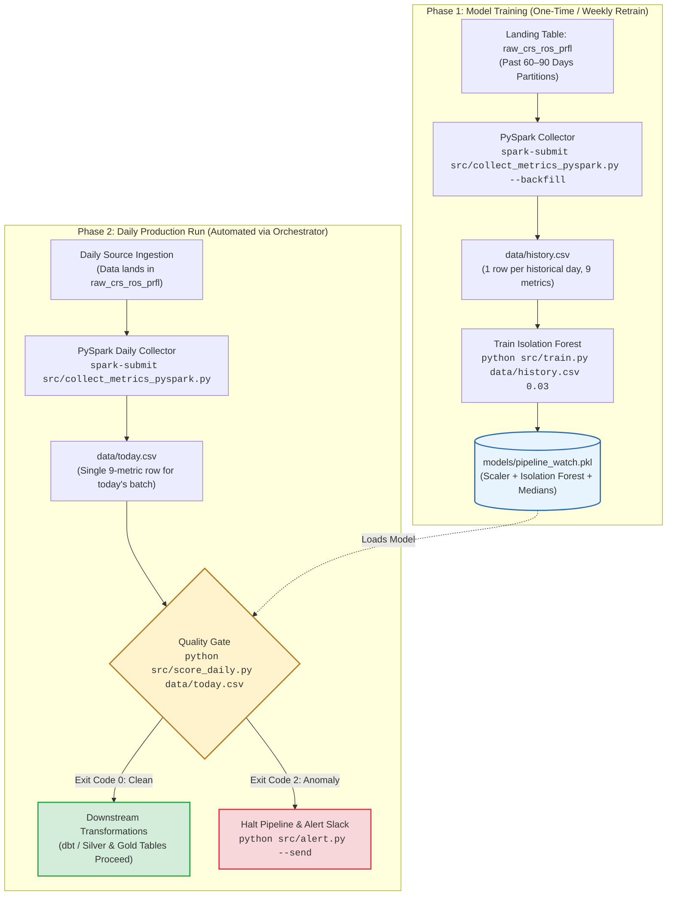
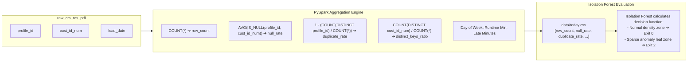
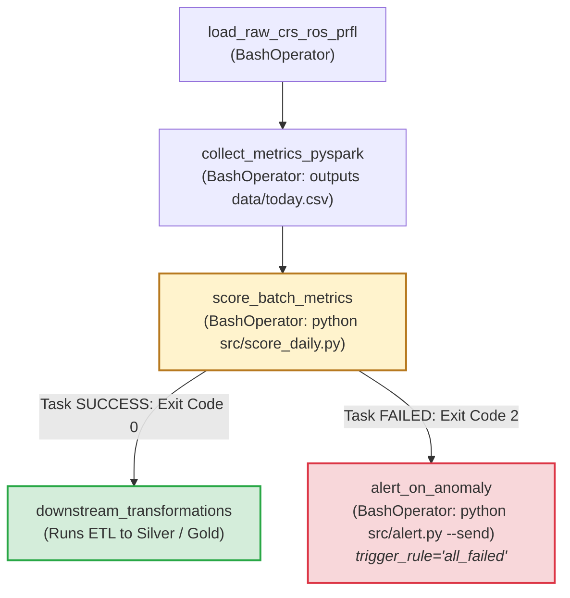
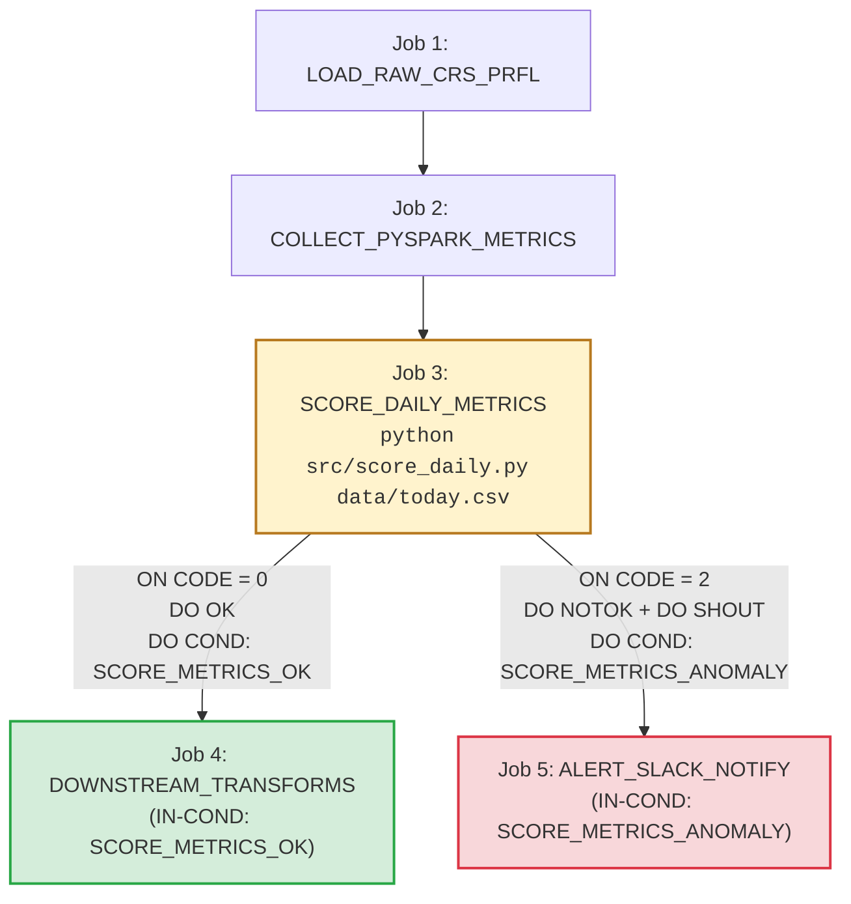

# Pipeline Watch — Architecture Flow & Production Operations

Complete end-to-end architecture, visual diagrams, and operational guide for unsupervised batch ETL anomaly detection on `raw_crs_ros_prfl`.

---

## 1. Visual Architecture Diagrams

### Diagram 1: End-to-End System Lifecycle



---

### Diagram 2: Data-Level Feature Extraction from `raw_crs_ros_prfl`



---

### Diagram 3: Airflow DAG Execution Flow



---

### Diagram 4: Control-M SMART Folder Flow (Return Code Branching)



---

## 2. The 9 Operational Metrics Captured

Instead of rigid static thresholds that break on seasonal shifts, the system tracks 9 multidimensional features:

| Metric | Source | Purpose / What it Detects |
| :--- | :--- | :--- |
| `batch_id` | Metadata / Date | Unique batch partition identifier |
| `day_of_week` | Job timestamp | Day index (0=Mon .. 6=Sun) to model weekend vs. weekday volume patterns |
| `row_count` | `raw_crs_ros_prfl` | Truncated loads, missing files, or massive unexpected fan-outs |
| `null_rate` | `profile_id`, `cust_id_num` | Upstream schema drift, source API changes ingesting empty values |
| `duplicate_rate` | `profile_id` | Accidental replay, re-ingestion of yesterday's batch, or bad join fan-out |
| `reject_rate` | Audit / error table | Encoding issues, delimiter corruption causing raw record rejects |
| `avg_amount` | Numeric attribute | Numerical distribution shifts (defaults to `0.0` if profile is non-financial) |
| `distinct_keys_ratio` | `cust_id_num / row_count` | Ratio of distinct customers to profiles (detects dummy ID spam or key collapse) |
| `runtime_min` | Job scheduler duration | Network throttling, DB lock contention, hung ingestion jobs |
| `late_minutes` | Scheduler SLA delay | Upstream vendor delays past expected delivery time |

---

## 3. Step-by-Step Production Execution

### Phase 1: One-Time Bootstrap (Model Training)
Before running daily scoring, the Isolation Forest must learn baseline patterns across historical data.

1. **Extract 60–90 days of history across past batch partitions:**
   ```bash
   spark-submit src/collect_metrics_pyspark.py \
       --table raw.raw_crs_ros_prfl \
       --batch-col load_date \
       --backfill \
       --output data/history.csv
   ```
   * Output: `data/history.csv` with one row per past batch.

2. **Train & Save the Baseline Model:**
   ```bash
   python src/train.py data/history.csv 0.03
   ```
   * Contamination rate `0.03` assumes ~3% of historical runs had anomalies.
   * Output: `models/pipeline_watch.pkl` (scaler + IsolationForest model + feature medians).

---

### Phase 2: Daily Production Flow (Scheduled Load)

Every day after the raw table load finishes, the orchestrator executes:

1. **Step 1 — Raw Ingestion:**
   Data lands into table `raw_crs_ros_prfl`.

2. **Step 2 — PySpark Metric Collection:**
   The collector aggregates today's landed records into 1 single row:
   ```bash
   spark-submit src/collect_metrics_pyspark.py \
       --table raw.raw_crs_ros_prfl \
       --batch-id "raw_crs_ros_prfl_$(date +%Y%m%d)" \
       --output data/today.csv \
       --runtime-min 25.0 \
       --late-minutes 0.0
   ```
   * Output: `data/today.csv` (1 header row + 1 data row).

3. **Step 3 — Score Today's Batch (Quality Gate):**
   ```bash
   python src/score_daily.py data/today.csv
   ```
   * Output: `outputs/scored_today.csv` and `outputs/alerts.txt`.
   * Standardized Process Exit Codes:
     * **Exit Code `0`:** Normal batch.
     * **Exit Code `2`:** Anomaly detected.
     * **Exit Code `1`:** Runtime error / crash.

---

### Phase 3: Branching & Automated Alerting

* **When Normal (Exit Code `0`):**
  Downstream transformations (dbt, Silver/Gold data marts) run automatically without delay.

* **When Anomaly Detected (Exit Code `2`):**
  * Downstream transformations are **halted immediately** to prevent bad data propagation.
  * Plain-English diagnosis is written to `outputs/alerts.txt`:
    ```text
    ALERT batch raw_crs_ros_prfl_20261122: score 0.241 — null_rate 0.420 (normal ~0.001); row_count 14500 (normal ~210000)
    ```
  * Alerter task sends notification:
    ```bash
    python src/alert.py --send
    ```

---

## 4. Scheduler Implementation Matrix

| Step | Airflow ([airflow_dag.py](file:///c:/Users/Nishith%20Reddy/Downloads/Data-AI-Detect/orchestration/airflow_dag.py)) | Control-M ([CONTROL_M_GUIDE.md](file:///c:/Users/Nishith%20Reddy/Downloads/Data-AI-Detect/orchestration/CONTROL_M_GUIDE.md)) |
| :--- | :--- | :--- |
| **Ingestion** | `load_raw_crs_ros_prfl` (BashOperator) | Job `LOAD_RAW_CRS_PRFL` |
| **Collection** | `collect_metrics_pyspark` (BashOperator) | Job `COLLECT_PYSPARK_METRICS` |
| **Scoring Gate** | `score_batch_metrics` (BashOperator) | Job `SCORE_DAILY_METRICS` |
| **Clean Batch (`RC=0`)** | Proceeds downstream automatically | `ON CODE = 0` $\to$ `DO OK` $\to$ triggers `DOWNSTREAM_TRANSFORMS` |
| **Anomaly (`RC=2`)** | `alert_on_anomaly` runs via `trigger_rule="all_failed"` | `ON CODE = 2` $\to$ `DO NOTOK` + `DO SHOUT` $\to$ triggers `ALERT_SLACK_NOTIFY` |

---

## 5. Ongoing Maintenance (Weekly)

1. **Rolling Retrain:** Retrain weekly on the rolling last 90 days:
   ```bash
   python src/train.py data/history.csv 0.03
   ```
2. **Threshold Tuning:**
   * Too many false alarms: Lower contamination to `0.02` or `0.01`.
   * Missed a bad batch: Raise contamination to `0.04` or `0.05`.
